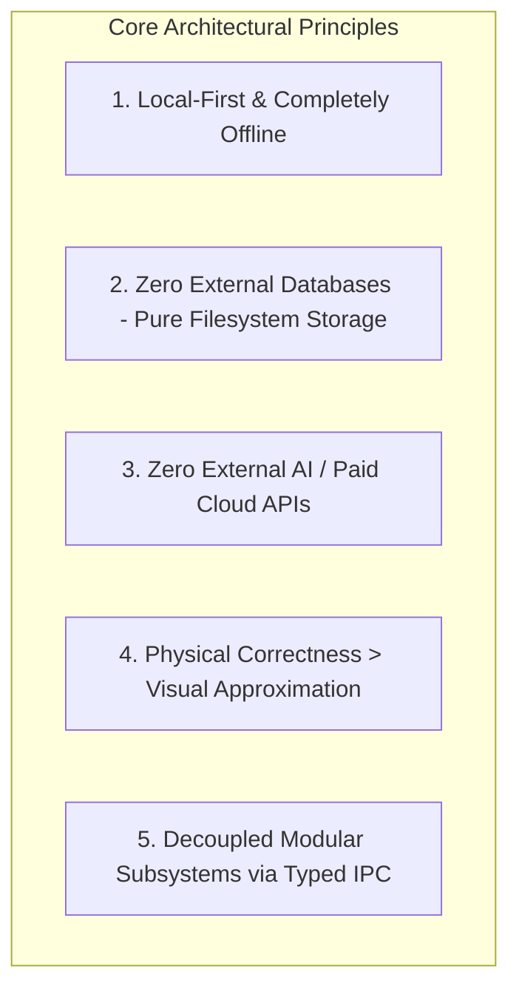
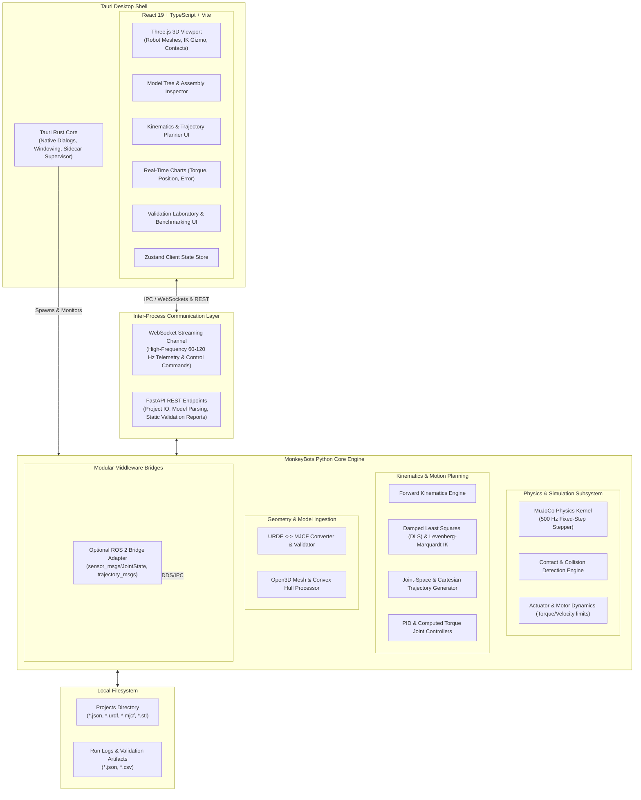
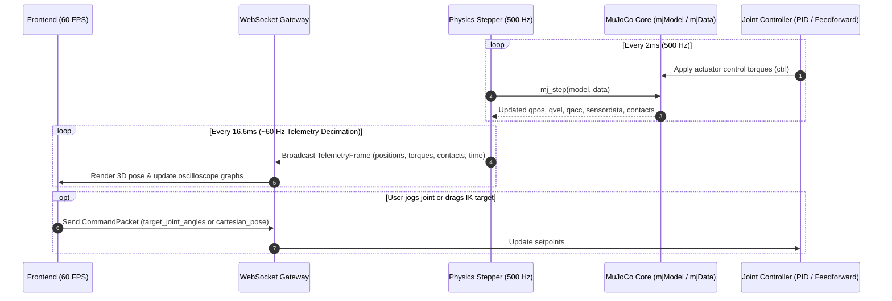
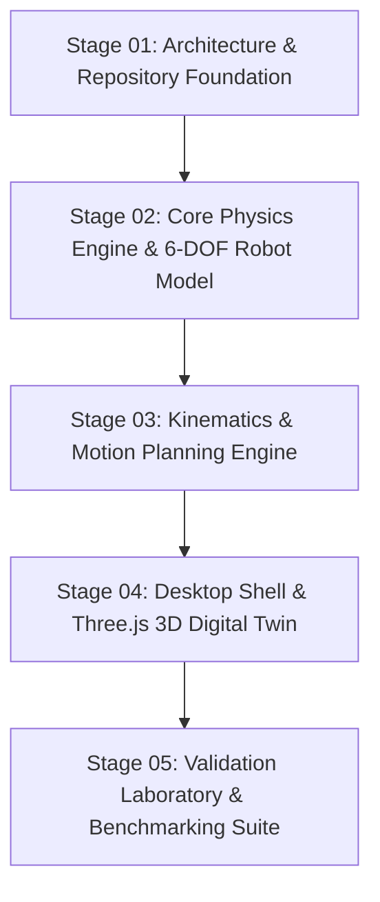

# MonkeyBots Architecture Specification — Stage 01
**Document Version:** 1.0.0  
**Status:** Approved Architecture Baseline  
**Author:** Principal Software Architect  
**Platform Target:** Windows 11 (64-bit), Linux (x86_64), macOS (Apple Silicon / Intel)

---

## 1. Executive Summary & Audit Findings

MonkeyBots is a local-first robotics engineering and simulation platform designed for high-fidelity physical simulation, kinematics planning, digital twin visualization, and validation benchmarking.

### 1.1 Host Environment Audit

The host workstation environment was verified:
- **Operating System:** Microsoft Windows 11 Home Single Language 64-bit (Build 10.0.26200)
- **Processor:** AMD Ryzen 7 7435HS (8 Cores, 16 Logical Processors)
- **Memory:** 24 GB Physical RAM (7.5 GB Available)
- **Runtime Toolchains:**
  - **Python:** 3.11.9 (64-bit) with `pip 26.2.1`
  - **Node.js:** v22.21.1 with `npm 11.4.2`
  - **Rust / Cargo:** 1.92.0 (`x86_64-pc-windows-msvc`)
  - **C/C++ & Build Tools:** CMake 4.4.3, GCC/G++ (UCRT64 MinGW) & MSVC host toolchain
  - **Edge WebView2 Evergreen Runtime:** Installed (`v157.0.4341.46`) — meets Tauri prerequisites.
- **Dependency Compatibility Test:**
  - Wheel availability for Python 3.11 Windows 64-bit verified for `mujoco` (4.0.1), `fastapi`, `uvicorn`, `numpy`, `scipy`, and `open3d` (0.20.0).

### 1.2 Repository Audit
- **Git Tree:** Clean, tracking `origin/main` at `https://github.com/MackenzieCampbelAndross/MonkeyBots`.
- **Existing Artifacts:** MIT License, initial product overview README, and foundational architecture blueprint. All existing specifications and constraints have been preserved.

---

## 2. Architectural Principles & Constraints

MonkeyBots enforces the following non-negotiable system rules:



1. **Local-First & Offline:** Once installed, zero network requests to external servers are required. No authentication gate, no telemetry phoning home.
2. **Zero Database Engine:** No SQLite, PostgreSQL, MongoDB, or Redis. Projects reside directly on the local filesystem as clear, human-readable directory trees containing JSON manifests, URDF/MJCF models, and standard binary or CSV/JSON run logs.
3. **Reproducible Simulation:** Physics execution is deterministic; stepping is strictly decoupled from rendering frame rates.

---

## 3. High-Level System Architecture



---

## 4. Frontend & Backend Boundaries

### 4.1 Frontend Scope (React + Three.js + Tauri)
- **Responsibilities:**
  - 3D visual rendering of robot meshes, frames, collision bounds, and end-effector trajectories.
  - Interactive camera controls (Orbit, Pan, Zoom, Focus-on-Joint).
  - Transform gizmo manipulation for target end-effector 6D poses.
  - Joint angle sliders and forward-kinematics manual jog controls.
  - Displaying real-time plots (joint positions, velocities, torques, tracking errors).
  - Project management UI (create, open, save, export).
- **Prohibitions:**
  - The frontend NEVER performs physics integration or forward Euler/Runge-Kutta stepping.
  - The frontend NEVER performs collision response calculations.

### 4.2 Backend Scope (Python + MuJoCo)
- **Responsibilities:**
  - High-precision numerical physics integration at 500 Hz (dt = 0.002 s).
  - Exact constraint solving (joints, limits, contacts, friction cones).
  - Inverse and Forward Kinematics computations with analytical/numerical Jacobians.
  - Continuous trajectory generation and interpolation.
  - Discrete PID loop execution and torque command synthesis.
  - Local file reading, writing, and URDF/MJCF validation.
- **Prohibitions:**
  - The backend does NOT handle UI state or visual shader rendering.

---

## 5. Simulation Engine Architecture (MuJoCo)

The physics engine is designed as a standalone, deterministic loop running at **500 Hz (configurable $\Delta t = 0.002\text{ s}$)**:



### Decoupled Substepping:
- Physics runs in a dedicated worker thread with high-resolution timing.
- Telemetry is decimated to $60\text{ Hz}$ or $120\text{ Hz}$ before serializing to WebSocket to avoid saturated IPC buffers.

---

## 6. Communication Protocols & Data Contracts

All IPC communication uses standard typed payloads.

### 6.1 WebSocket Real-Time Channel (`ws://127.0.0.1:8765/ws/simulation`)
- **Telemetry Frame (Server $\rightarrow$ Client at 60 Hz):**
  ```json
  {
    "type": "telemetry",
    "sim_time": 12.454,
    "real_time_factor": 1.002,
    "joint_names": ["joint_1", "joint_2", "joint_3", "joint_4", "joint_5", "joint_6"],
    "qpos": [0.0, -0.785, 1.57, 0.0, 0.785, 0.0],
    "qvel": [0.01, -0.02, 0.0, 0.0, 0.0, 0.0],
    "qtorque": [12.4, -45.2, 23.1, 1.2, 0.8, 0.1],
    "end_effector": {
      "position": [0.45, 0.12, 0.65],
      "quaternion": [1.0, 0.0, 0.0, 0.0]
    },
    "contacts": [
      { "geom1": "gripper_finger_l", "geom2": "cube_target", "force": 8.42 }
    ]
  }
  ```
- **Control Command (Client $\rightarrow$ Server):**
  ```json
  {
    "type": "command",
    "mode": "joint_position",
    "targets": [0.1, -0.7, 1.6, 0.0, 0.8, 0.0],
    "gripper": 0.04
  }
  ```

### 6.2 REST Endpoints (`http://127.0.0.1:8765/api/v1`)
- `GET /health` — Health check & toolchain verification.
- `POST /simulation/load` — Load a project manifest or MJCF/URDF model.
- `POST /simulation/control` — Start, pause, step, reset simulation.
- `POST /kinematics/fk` — Compute Forward Kinematics for given joint array.
- `POST /kinematics/ik` — Compute Inverse Kinematics for target 6D pose.
- `GET /projects` — List available local projects in the workspace.

---

## 7. Local Project Storage Conventions

Projects are stored in plain directory structures under the user's project folder:

```
<project_name>/
├── project.json              # Main project manifest & metadata
├── robot.mjcf                # Native MuJoCo XML description
├── robot.urdf                # Optional standard URDF representation
├── assets/                   # Visual & collision meshes (.stl, .obj, .dae)
│   ├── base_link.stl
│   └── ...
├── trajectories/             # Saved motion profiles & waypoints (.json)
│   ├── pick_and_place.json
│   └── calibration_sweep.json
└── runs/                     # Simulation experiment logs & reports
    └── run_20261116_202500/
        ├── manifest.json
        ├── telemetry.csv     # High-resolution time-series data
        └── report.md         # Generated validation report
```

### Project Manifest Schema (`project.json`):
- `version`: Manifest schema version (e.g. `"1.0.0"`).
- `name`: Human-readable robot or workspace name.
- `model_entry`: Relative path to `robot.mjcf` or `robot.urdf`.
- `physics_config`: Timestep ($0.002$), gravity ($[0, 0, -9.81]$), solver iterations.
- `controllers`: PID gain defaults ($K_p, K_i, K_d$) per joint.
- `initial_pose`: Default initial joint angles $\mathbf{q}_0$.

---

## 8. Error Handling & Logging Standards

1. **Structured Logging:**
   - Python backend utilizes `loguru` with structured JSON output formatting.
   - Severity levels: `DEBUG`, `INFO`, `WARNING`, `ERROR`, `CRITICAL`.
   - All logs include timestamp, component name, thread/task ID, and context.
2. **Graceful Physics Degradation:**
   - Numerical instability (NaN in velocities or divergence) triggers an immediate soft-pause of the physics stepper with error type `SIM_NUMERICAL_DIVERGENCE` sent to the frontend.
3. **Frontend Diagnostics:**
   - Toast notifications for non-critical warnings (e.g., target pose near kinematic singularity).
   - Modal alert with recovery options for fatal engine disconnections.

---

## 9. Dependency & Compatibility Risk Assessment

| Dependency | Target Version | Compatibility on Windows 11 | Risk Level | Mitigation Strategy |
|---|---|---|---|---|
| **MuJoCo** | `mujoco 4.0.1` | Native pre-built binary wheels for Python 3.11 Windows x64. | **LOW** | Direct pip install, zero compilation needed on user machine. |
| **Open3D** | `0.20.0` | Native pre-built wheels for Python 3.11 Windows x64. | **LOW** | Fully verified in environment audit. |
| **Tauri** | `v2.x` | Requires Rust 1.77+ and WebView2. | **LOW** | Host has Rust 1.92.0 and Evergreen WebView2 preinstalled. |
| **ROS 2 Integration** | Humble / Iron | Native Windows ROS 2 has high installation friction and prerequisites. | **MEDIUM** | **Architectural Isolation:** ROS 2 is implemented as an optional bridge adapter (via DDS/Zenoh or socket bridge). Core MonkeyBots operates 100% independently without ROS 2 installed. |
| **C++ Extensions** | C++17 | MSVC / MinGW UCRT64 present on system. | **LOW** | Python algorithms (NumPy/SciPy/MuJoCo) provide 500 Hz performance; C++ bindings are isolated to optional acceleration modules. |

---

## 10. Implementation Roadmap



- **Stage 01 (Current):** Repository audit, architectural baseline, directory scaffolding, data contracts, and dependency definitions.
- **Stage 02:** MuJoCo 500 Hz simulation kernel, parametric 6-DOF industrial robot arm model (MJCF), contact dynamics, and state serializer.
- **Stage 03:** Analytical & numerical kinematics (FK, DLS IK), trajectory generators (quintic polynomial, Cartesian linear), and discrete joint PID controllers.
- **Stage 04:** Tauri desktop application shell, React + Three.js 3D digital twin viewport, interactive gizmos, and real-time telemetry streaming over WebSockets.
- **Stage 05:** Automated validation test suite (tracking error, step response, stability, collision impulse) and exportable engineering reports.
